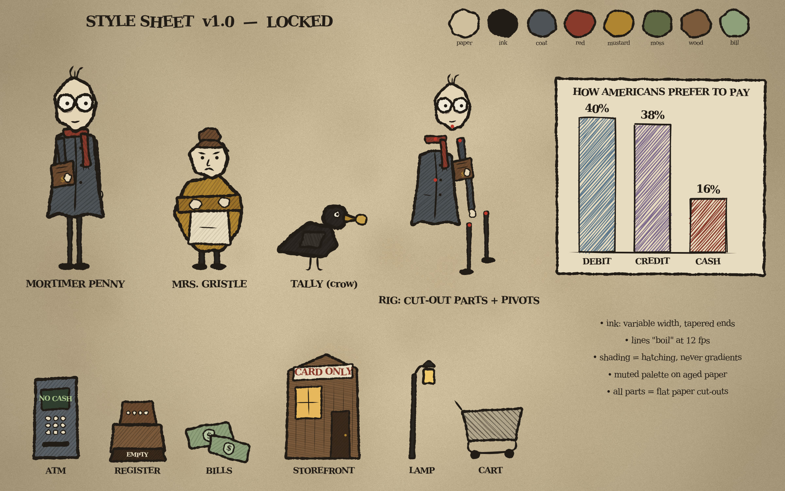

# Small Catastrophes

Video pipeline for the **Small Catastrophes** channel: "what happens, hour by hour, when everyday things break."
A script in JSON goes in; a hand-drawn gothic explainer video comes out.



## How it works

1. `episodes/<name>/script.json` — scenes, lines of narration, data cards and their sources.
2. `scripts/tts.py` — reads every line with the Kokoro voice **bm_george** (one call per line, so each line has an exact start and end time) and writes `build/<name>/narration.wav` + `timeline.json`.
3. `scripts/render.mjs` — opens `src/player.html` in headless Chrome, draws every frame and pipes them to ffmpeg → `build/<name>/video.mp4`.

Drawing is all code: wobbly ink lines (perfect-freehand), hatching (Rough.js), aged paper, characters as paper cut-outs with pivots. Lines "boil" at 12 fps.

## Setup

Needs Node 18+, Python 3.10+, ffmpeg and Google Chrome.

```bash
./scripts/setup.sh                       # npm + pip deps, downloads the Kokoro model (~120 MB)
```

## Make a video

```bash
python3 scripts/lint.py episodes/demo-day1/script.json       # location / pacing rules (before any voice or render)
python3 scripts/tts.py episodes/demo-day1/script.json        # per-line cache in build/tts-cache: only changed lines are re-voiced
node scripts/render.mjs episodes/demo-day1 --frames 40,250   # stills to review first
python3 scripts/audio.py episodes/demo-day1/script.json      # music bed + SFX + mix (all synthesised) → mix.wav
node scripts/render.mjs episodes/demo-day1                   # full video (uses mix.wav when present)
node scripts/render.mjs episodes/demo-day1 --remux           # new sound on a finished video, no frames rendered
node scripts/thumbnail.mjs episodes/demo-day1                # thumbnail(s) from the "thumbnail" spec + watermark.png
python3 scripts/make_short.py episodes/ep01-cash-vanished/script.json short1 "Hook text" 0,1,8   # vertical Short
```

Render speed on 2 CPU cores: ~1.6 s of render per 1 s of video (19 s demo in 31 s).

## Writing an episode (v0.4 rules)

1. **Location plan first.** Split the episode into segments and give each a place before writing lines (`"plan"` in the script).
2. **Variety is checked, not hoped for.** `lint.py` fails the script when one place runs more than 2 shots or 30 s in a row,
   when the board (charts/maps) passes 25 % of runtime, or when the episode has fewer than 6 locations; it warns on shots over
   12.5 s and on numbers without a `source`.
3. A place is set + locale: the U.S. street and the Indian street count as different places.

## v0.5 additions

| Key | What |
|---|---|
| `brand: "intro"` + `duration` | 3–4 s sting: ink blot, logo stamp, name writes itself, tagline |
| `set: "endcard"` + `duration` | 15 s end screen: two 16:9 boxes for YouTube "watch next" elements, Mortimer waves |
| `duration` | shots without lines hold for a fixed time |
| `vertical: true`, `hook` | 9:16 output: hook on top, shot cropped near-square in the middle (charts crop on the board), big captions below |
| `thumbnail` | `{time, shift, title: [..], accent, stamp, size, ty, sx, sy}` or a list of them for A/B variants |
| audio | `audio.py`: D-minor music-box waltz + drone, ducked under speech; tear / ink / iris / stamp / card / chart / headline / intro sounds from the timeline |

## v0.4 additions

| Key | What |
|---|---|
| sets | `street`, `supermarket`, `desk`, **`bank`, `home`, `busstop`, `laundromat`, `market`, `hall`, `table`** |
| `variant` | `{locale: us/in/ng/se, sky: night/dusk/day, sign, atm, shopSign, bankSign, hallSign, cur, noCart, jarEmpty}` — signs, currency, sky and crowd skin tones follow the locale |
| `insert` | `{prop: notes/wallet/ledger/phone/atmScreen/tipjar/scrip, text: [...], scale, tilt}` on `set: "table"` — close-up of an object |
| `headline` | `{paper, date, text, sub, source}` — a newspaper spins in over the shot |
| `panels` | 2–3 sub-shots side by side (`set`, `variant`, `actors`, `camera`, `label`, `at`); `reveal: true` brings them in one by one |
| `map.region: "world"` | world map; `highlight: [{name, label, at, offset}]` lights up countries with labels |
| townsfolk | six skin tones mixed per locale, eye whites, hair colours; `age: old/adult/young` on an actor or a crowd (crowd may give a list to mix) — old: grey hair, lines, glasses, stoop, cane; young: hoodie, bright colours, phone |
| render chunks | named by a hash of the shots they cover: editing a shot re-renders only its chunk; `--fresh` after changing drawing code |
| captions | break at punctuation, never end a chunk on a joining word |
| audio | narration normalised to −16 LUFS at mux |

## v0.3 additions

| Key | What |
|---|---|
| `camera.move: "follow"` | camera tracks a walking actor (`camera.on`) |
| parallax | sets can define `far()` (moves at 0.35× on pans) and `front()` (1.15×) |
| `{"crowd": {n, seed, area: [x0,y0,x1,y1], walk: "left"/"right"/"both", speed, queue, fidget}}` | expands into generated townsfolk; size follows the set's depth rule |
| `map` | `{title, dots: {n, seed, counter, label}, source}` — US map draws itself in, then dots and a counter |
| mouth shapes | `tts.py` writes a mouth shape per frame (closed / open / round / wide) from the narration's spectrum |
| walking | eyes look along the path and the body leans into the walk |
| `--workers N` | `render.mjs` splits frames across N browsers and joins the parts without re-encoding |

## Shot list format (v0.2)

`episodes/v02-test/script.json` is the reference. Each shot:

| Key | Values |
|---|---|
| `set` | `street`, `supermarket`, `desk` (chart inserts) |
| `camera` | `size`: wide / medium / close; `on`: actor id or `[x, y]`; `move`: push / pull / pan-left / pan-right / static |
| `actors` | `who`: mortimer / gristle / tally / `person:<n>` (generated townsfolk); `at`, optional `to` + `walk: [start, dur]`; `actions: [{do, at, dur}]` with startle, point-left, point-right, shrug, raise, nod, peck; `layer: "behind"` puts them behind the set's front layer (e.g. behind the counter) |
| `transition` | `ink`, `iris`, `tear` (or a plain cut) ; `fadeIn` / `fadeOut` |
| `chart` | `{title, subtitle, bars: [[label, value]], unit, decimals, highlight, source}` — bars draw themselves in |
| `vo` | `true` = narrator off-screen (nobody's mouth moves) |
| `stamp` | time stamp card, e.g. `HOUR 8` |

The old `scenes` format (v0.1) still works.

## Script format (v0.1)

```json
{
  "voice": "bm_george", "speed": 0.95, "fps": 24, "size": [1920, 1080],
  "scenes": [{
    "set": "street", "stamp": "DAY 1", "camera": { "push": 0.07 },
    "lines": [
      { "text": "Only sixteen percent of Americans prefer to pay in cash.",
        "card": { "big": "16%", "small": "prefer to pay in cash" },
        "source": "Federal Reserve, Diary of Consumer Payment Choice (2026)" }
    ]
  }]
}
```

- `card` shows from its line until the next card. `gesture: "raise"` makes Mortimer lift his ledger during that line.
- Every number on screen needs a `source`.

## Layout

| Path | What |
|---|---|
| `src/ink.js` | drawing toolkit: ink lines, hatching, paper, hand lettering |
| `src/cast.js` | Mortimer Penny, Mrs. Gristle, Tally the crow, props (parts + pivots) |
| `src/sets.js` | backgrounds and where characters stand in them |
| `src/player.js` | turns a timeline into frames |
| `src/brand.js` | logo, banner, Facebook cover, title lettering |
| `assets/` | approved brand files and style sheet |
| `docs/STYLE.md` | locked style rules |

## Licenses

Code deps: perfect-freehand, Rough.js, puppeteer-core (MIT). Voice model: Kokoro-82M (Apache-2.0). Font: DejaVu Serif (temporary — replace with a commercially licensed hand-lettered font).
Characters and style are original; inspired by gothic hand-drawn games but no Klei/Don't Starve assets, names or characters are used.

## YouTube agent skills

`.claude/skills/yt-*` is a vendored copy of [youtube-agent-skill](https://github.com/Jakeschincariol/youtube-agent-skill) (MIT, see `.claude/skills/YT_AGENT_LICENSE`). Claude Code sessions opened in this repo load them as `/yt-script`, `/yt-package`, `/yt-seo`, `/yt-chapters`, `/yt-shorts`, `/yt-comment`, etc. They draft content only; uploading and scheduling still happen in YouTube Studio / Facebook via Chrome.

Before using them: `mkdir -p ~/.claude/youtube && cp .claude/youtube/voice.md ~/.claude/youtube/voice.md`
